# FIAP — Faculdade de Informática e Administração Paulista

<p align="center">
  <a href="https://www.fiap.com.br/">
    
  </a>
</p>

<br>
<h2 align="center">Coração em Imagens: Assistente Cardiológico Virtual com Visão Computacional</h2>

<p align="center">
  <strong>Aluno:</strong> Richard Schmitz &nbsp;|&nbsp; <strong>RM:</strong> 567951<br>
  <strong>Curso EAD:</strong> Inteligência Artificial - FIAP &nbsp;|&nbsp; <strong>Fase:</strong> 4  Pulso: Inteligência Cardiológica com Consciência de Dados
</p>

---


---

# Pulso Fase 4: Coração em Imagens

O Pulso simula o ecossistema de dados de uma plataforma de cardiologia inteligente. Ao longo de sete fases, o projeto integra Machine Learning, IoT, Visão Computacional, NLP e séries temporais aplicados à saúde cardiovascular.

Esta é a Fase 4: um protótipo de assistente que classifica radiografias de tórax como **cardiomegalia** (aumento da silhueta cardíaca) ou **sem achados**. A fase compara uma CNN treinada do zero com outra treinada por Transfer Learning sobre a ResNet50, apresenta os resultados em um protótipo interativo em um notebook (com Grad-CAM, limiar explícito e aviso de uso) e mede, no Ir Além 1, se o modelo erra de forma diferente por sexo, faixa etária e tipo de radiografia.

---

## Resumo da fase

| Item | Resultado |
|---|---|
| Dataset | NIH Chest X-rays (amostra do Kaggle): 5.606 imagens, das quais 3.185 entram no experimento (141 com cardiomegalia, 4,43%) |
| Divisão | Por paciente, estratificada, semente 42: treino 2.277, validação 462, teste 446 (19 positivos no teste) |
| CNN do zero | AUC-ROC 0,668, recall 0,316, precisão 0,118 no teste |
| ResNet50 | AUC-ROC 0,845, recall 0,895, precisão 0,108 no teste |
| Limitação principal | Precisão em torno de 0,11 em ambos os modelos: a maior parte das imagens sinalizadas não apresenta cardiomegalia no laudo. A acurácia da ResNet50 (0,682) fica abaixo da referência que responde sempre "sem achados" (0,957) |
| Fairness por sexo | ResNet50: nenhuma das 5 métricas mostra diferença demonstrada entre mulheres e homens, com apenas 19 positivos no teste. CNN do zero: 2 de 5 métricas mostram diferença (falsos positivos e AUC-ROC) |
| Achado principal do Ir Além 1 | A ResNet50 sinaliza 48,8% das radiografias AP sem achados contra 25,8% das PA (p < 0,001) |

Os números acima vêm de `resultados/` e das saídas dos notebooks executados. Esta fase é um protótipo acadêmico: nenhum resultado indica desempenho clínico.

---

## Continuidade com as Fases 1 a 3

- **Fase 1:** documentou o dataset, a governança e o eixo de viés de gênero em cardiologia. A Fase 4 retoma esse eixo no Ir Além 1, medindo o desempenho por sexo.
- **Fase 2:** avaliou viés por subgrupo e registrou pendências. Foi aplicado aqui: a análise por grupo usa apenas o conjunto de teste e traz o intervalo de confiança por bootstrap dos pacientes. **Não** foi aplicada validação cruzada, pois esta fase utiliza uma única divisão dos dados (pendência mantida). A pendência de converter o sinal de ECG em imagem e usar uma CNN também não foi retomada, pois esta fase trabalha com radiografias de tórax.
- **Fase 3:** a regra de não substituir uma falha por um valor plausível foi mantida no pré-processamento: idade inválida vira valor ausente, e o notebook para com erro se nenhuma idade for lida. O fluxo de sinais do Pulso Band ainda não está conectado ao módulo de imagem. A integração é objetivo da Fase 7.

---

## Eixo temático

O Pulso é construído em torno de uma questão de governança em saúde. Na Fase 4 ela ganha esta forma:

**um modelo de imagem só tem valor clínico se for possível dizer para quem e em que condições ele erra.**

Por isso, a fase não se limita a reportar a acurácia. Cada métrica vem com um intervalo de confiança; o limiar de decisão aparece junto a cada resultado, e o desempenho é apresentado por sexo (eixo do projeto), por faixa etária e por projeção da radiografia (AP ou PA). A abertura por projeção surgiu de uma observação do protótipo: o Grad-CAM de um falso positivo mostrou uma radiografia portátil em AP, o que levantou a hipótese de que o modelo reage ao tipo de exame. Ela foi testada na Parte C do Notebook 4 e os dados a sustentam (ver [Ir Além 1](#ir-além-1--ética-e-governança-em-visão-computacional)).

---

## Pipeline da Fase 4

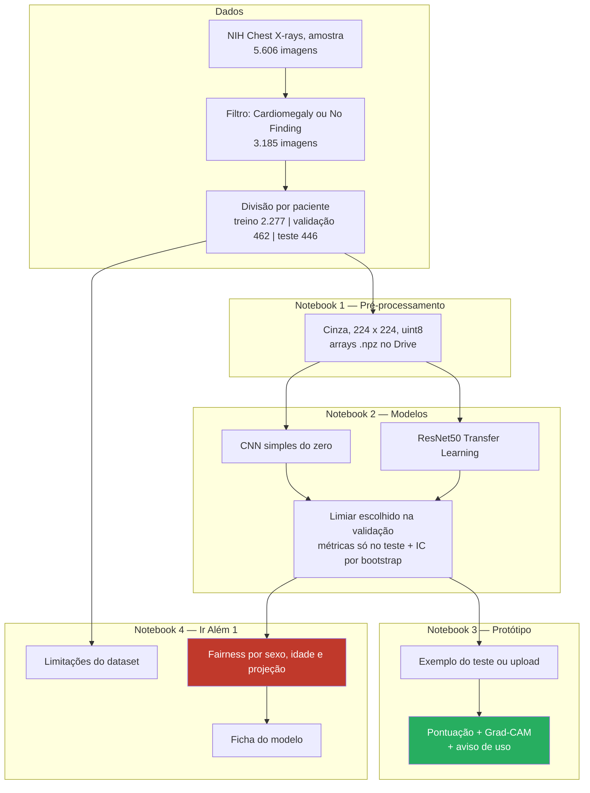

---

## Estrutura do repositório

```
Pulso_F4/
│
├── README.md
│
├── notebooks/
│   ├── 01_preprocessamento.ipynb        ← Parte 1: pré-processamento e divisão por paciente
│   ├── 02_cnn_transfer_learning.ipynb   ← Parte 2: CNN do zero, ResNet50 e métricas
│   ├── 03_prototipo.ipynb               ← Parte 2: protótipo interativo com Grad-CAM
│   └── 04_fairness_governanca.ipynb     ← Ir Além 1: limitações, fairness e ficha do modelo
│
├── scripts/
│   └── comparacao_pareada.py            ← Comparação pareada CNN x ResNet50 (gera um JSON)
│
├── resultados/                          ← Saídas pequenas dos notebooks (copiadas do Drive)
│   ├── pipeline_resumo.json             ← Notebook 1: contagens e versões
│   ├── splits.csv                       ← Notebook 1: partição de cada imagem
│   ├── metricas_nb2.json                ← Notebook 2: todas as métricas e hiperparâmetros
│   ├── pred_val_*.csv, pred_teste_*.csv ← Notebook 2: pontuações por imagem
│   ├── exemplos_nb3.json                ← Notebook 3: exemplos registrados
│   ├── nb4_*.csv                        ← Notebook 4: tabelas de fairness
│   ├── ficha_do_modelo.json             ← Notebook 4: ficha do modelo (formato de máquina)
│   └── comparacao_pareada.json          ← Gerado por scripts/comparacao_pareada.py
│
├── docs/
│   ├── relatorio_parte1_preprocessamento.md   ← Relatório da Parte 1 (1 a 2 pg)
│   ├── relatorio_parte1_preprocessamento.pdf  ← Mesmo relatório em PDF, para envio
│   ├── relatorio_iralem1_fairness.md          ← Relatório do Ir Além 1 (até 2 pg)
│   └── ficha_do_modelo.md                     ← Ficha do modelo (formato de leitura)
│
└── assets/
    └── (figuras geradas pelos notebooks: nb1_*, nb2_*, nb3_*, nb4_*)
```

---

## Parte 1: Pré-processamento e organização das imagens

### Dataset

| Campo | Informação |
|---|---|
| Nome | NIH Chest X-rays, versão amostra |
| Fonte usada no projeto | Kaggle: `nih-chest-xrays/sample` (https://www.kaggle.com/datasets/nih-chest-xrays/sample) |
| Provedor | NIH Clinical Center. Download oficial: https://nihcc.app.box.com/v/ChestXray-NIHCC |
| Artigo de referência | Wang X. et al. *ChestX-ray8: Hospital-scale Chest X-ray Database and Benchmarks on Weakly-Supervised Classification and Localization of Common Thorax Diseases*. IEEE CVPR, 2017, pp. 3462-3471 (https://arxiv.org/abs/1705.02315) |
| Rótulos | Extraídos dos laudos por meio de processamento de linguagem natural (Wang et al., 2017). Sem validação clínica independente neste projeto |
| Licença e atribuição | Segundo a [documentação do Google Cloud](https://docs.cloud.google.com/healthcare-api/docs/resources/public-datasets/nih-chest) para o dataset do NIH, não há restrições de uso, mas são exigidos o link para o site de download do NIH, a citação do artigo CVPR 2017 e o reconhecimento do NIH Clinical Center como provedor. O campo de licença da página do Kaggle não pôde ser consultado automaticamente |
| Tamanho original das imagens | 1024 x 1024 pixels (amostra de 300 imagens conferida no Notebook 1) |

As imagens **não** estão neste repositório (consulte [Rastreabilidade](#rastreabilidade-dos-artefatos)).

### Decisões do pipeline

| Decisão | Escolha | Por quê |
|---|---|---|
| Tarefa | Classificação binária: cardiomegalia (1) contra sem achados (0) | Mantém o foco cardiovascular do projeto e permite métricas simples de interpretar |
| Imagens com outras doenças e sem cardiomegalia | Excluídas (2.421 de 5.606) | Evitam um rótulo 0 ambíguo. Consequência: o modelo não é testado contra outras doenças |
| Divisão | **Por paciente**, estratificada em cerca de 70% / 15% / 15% | Cada paciente tem, em média, 1,15 imagens (máximo de 6). Dividir por imagem colocaria o mesmo paciente em treino e teste |
| Cor | Escala de cinza, 1 canal | Radiografia é monocromática |
| Tamanho | 224 x 224, interpolação LANCZOS | Entrada padrão de VGG16 e ResNet |
| Normalização | 0 a 255 para 0 a 1, aplicada dentro do modelo | Os arquivos ficam em `uint8`, menores |
| Formato salvo | Arrays `uint8` em `.npz` | Carregamento rápido |
| Idade inválida | Vira valor ausente, nunca valor plausível | Regra herdada da Fase 3 |
| Semente | 42 | Reprodutibilidade |

### Resultado do pipeline

- 3.185 imagens no experimento (3.044 sem achados e 141 com cardiomegalia, prevalência de 4,43%) de 2.762 pacientes.
- O notebook verifica, por meio de um `assert`, que nenhum paciente aparece em duas partições.
- Idades lidas: 3.184 de 3.185 registros. 1 registro tinha idade fora do intervalo de 0 a 100 anos e foi marcado como ausente.

| Partição | Imagens | Pacientes | Positivos | Prevalência | Sexo F | Sexo M |
|---|---|---|---|---|---|---|
| Treino | 2.277 | 1.975 | 100 | 4,39% | 990 | 1.287 |
| Validação | 462 | 392 | 22 | 4,76% | 232 | 230 |
| Teste | 446 | 395 | 19 | 4,26% | 194 | 252 |

<p align="center">
  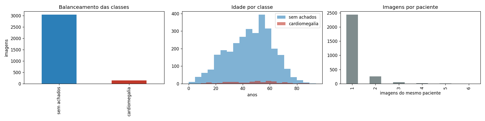
</p>

Conferência visual (4 imagens de cada classe, antes e depois do pré-processamento):

<p align="center">
  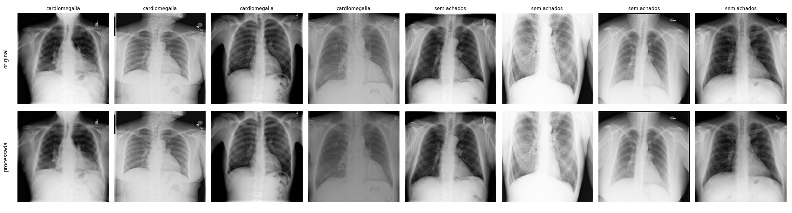
</p>

**Correção feita durante a fase:** a primeira execução do Notebook 1 leu zero idades sem avisar, porque a coluna vinha como texto (por exemplo, `058Y`) e a conversão para numérico transformava tudo em valores ausentes. O parsing foi corrigido (função `limpar_metadados`, seção 4 do notebook), e uma verificação passou a interromper a execução caso nenhuma idade seja lida (na mesma seção).

Relatório da parte: [`docs/relatorio_parte1_preprocessamento.md`](docs/relatorio_parte1_preprocessamento.md) (versão em PDF: [`docs/relatorio_parte1_preprocessamento.pdf`](docs/relatorio_parte1_preprocessamento.pdf)).

---

## Parte 2: Classificação de imagens médicas com CNN

### Modelos

| | CNN simples (do zero) | ResNet50 (Transfer Learning) |
|---|---|---|
| Arquitetura | 5 blocos Conv, BatchNormalization, ReLU e MaxPooling (16, 32, 64, 128, 128 filtros), média global, Dropout 0,4, saída sigmoide | ResNet50 com pesos da ImageNet, canal replicado para 3, subtração da média da ImageNet, média global, Dropout 0,3, saída sigmoide |
| Parâmetros | 245.969 | 23.589.761 |
| Treino | Adam, taxa de 1e-3, até 40 épocas (executadas: 23) | Fase 1: só a cabeça, taxa de 1e-3 (8 épocas). Fase 2: bloco `conv5_` liberado, BatchNormalization congelada, taxa 1e-5 (10 épocas) |
| Limiar | 0,79 | 0,35 |

Comuns aos dois: peso de classe `N / (2 x N_classe)` calculado no treino (0,523 para sem achados e 11,385 para cardiomegalia), aumento de dados leve (rotação, deslocamento, zoom e contraste) **sem espelhamento horizontal**, parada antecipada pela AUC-PR da validação e limiar escolhido na **validação**, maximizando o F1. O conjunto de teste só entra na avaliação final. A ResNet50 foi a escolha padrão entre as duas opções do enunciado (VGG16 ou ResNet); não foi feita uma comparação com a VGG16.

### Resultados no teste (446 imagens, 19 positivos)

| Modelo | Limiar | Acurácia | Precisão | Recall | F1 | AUC-ROC | AUC-PR |
|---|---|---|---|---|---|---|---|
| Referência: sempre "sem achados" | - | 0,957 | 0,000 | 0,000 | 0,000 | 0,500 | 0,043 |
| CNN simples (do zero) | 0,79 | 0,870 | 0,118 [0,000 a 0,250] | 0,316 [0,000 a 0,522] | 0,171 [0,000 a 0,318] | 0,668 [0,510 a 0,772] | 0,085 [0,027 a 0,204] |
| ResNet50 (Transfer Learning) | 0,35 | 0,682 | 0,108 [0,045 a 0,183] | 0,895 [0,687 a 1,000] | 0,193 [0,085 a 0,306] | 0,845 [0,748 a 0,908] | 0,157 [0,059 a 0,345] |

Intervalos de confiança de 95% por bootstrap com 1000 repetições, reamostrando os pacientes.

| Modelo | Verdadeiros negativos | Falsos positivos | Falsos negativos | Verdadeiros positivos |
|---|---|---|---|---|
| CNN simples (do zero) | 382 | 45 | 13 | 6 |
| ResNet50 (Transfer Learning) | 287 | 140 | 2 | 17 |

<p align="center">
  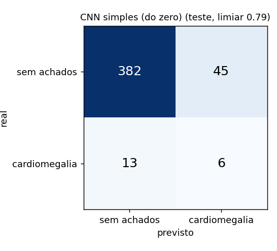
  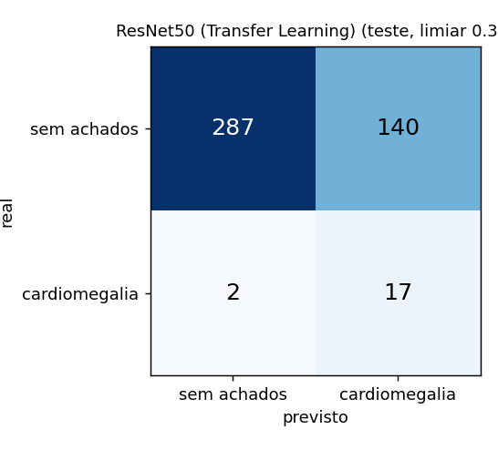
</p>

<p align="center">
  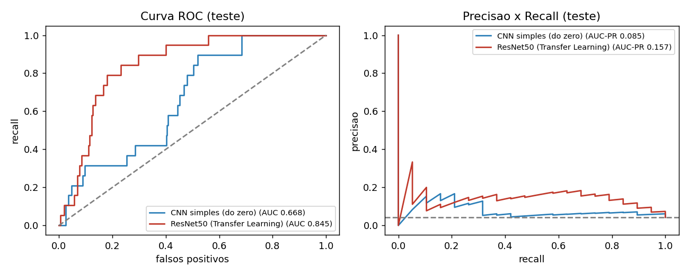
</p>

<p align="center">
  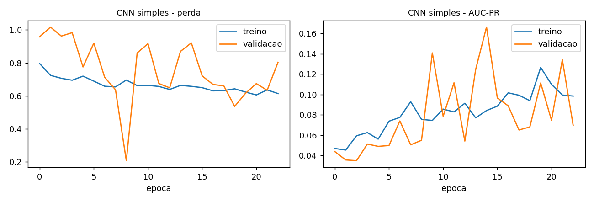
  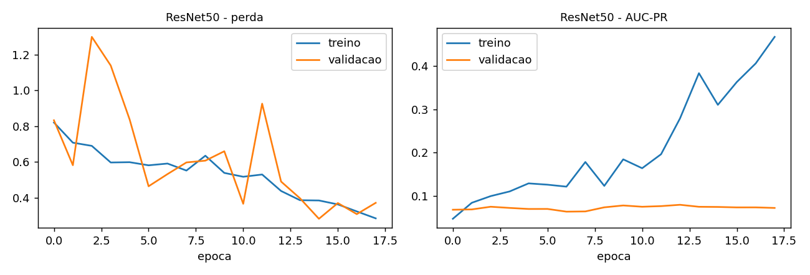
</p>

### Como ler esses resultados

- **A ResNet50 opera com alta sensibilidade e baixa precisão.** Com o limiar 0,35 ela sinaliza 157 das 446 imagens do teste (35,2%), acerta 17 dos 19 casos e gera 140 falsos positivos. A acurácia (0,682) fica abaixo da referência, que sempre responde "sem achados" (0,957). Por isso, a acurácia não é usada como métrica principal.
- **A ResNet50 ordena os casos melhor do que a CNN do zero.** AUC-ROC 0,845 contra 0,668. A diferença pareada, calculada por [`scripts/comparacao_pareada.py`](scripts/comparacao_pareada.py), é de 0,183, com IC de 95% [0,086 a 0,301], que exclui zero. Na AUC-PR, a diferença é 0,072 com IC [-0,040 a 0,202], que inclui zero: a vantagem em AUC-PR não está demonstrada.
- **Na validação, a ordem se inverte:** AUC-ROC de 0,741 para a CNN e de 0,692 para a ResNet50. Com um único conjunto de teste de 19 positivos, a vantagem da ResNet50 deve ser tratada como hipótese.
- **A ResNet50 sobreajusta.** No gráfico de treino, a AUC-PR do treino sobe enquanto a da validação permanece estável. A parada antecipada restaurou os melhores pesos.
- **Os resultados variam entre execuções.** Em uma execução anterior da mesma configuração, descartada e não preservada neste repositório, a ResNet50 deu AUC-ROC de 0,79 e limiar de 0,85. Os valores oficiais são os de [`resultados/metricas_nb2.json`](resultados/metricas_nb2.json), da execução final.

### Protótipo de apresentação (Notebook 3)

O protótipo é uma interface interativa no notebook (`ipywidgets`), com duas abas: **Exemplos do teste** (escolhe uma radiografia do conjunto de teste, filtrando pelo laudo) e **Enviar imagem** (PNG ou JPG, mantida apenas na memória da sessão). Para cada imagem ele mostra:

- o original, a entrada do modelo (224 x 224) e o **Grad-CAM** da última camada convolucional;
- a pontuação do modelo e o limiar. Ela é chamada de "pontuação" e não de probabilidade, porque o modelo não é calibrado;
- a decisão ("sinalizada para revisão" ou "não sinalizada"), com a frase de que "não sinalizada" não exclui cardiomegalia;
- o contexto do teste (recall, precisão e falsos positivos) e o aviso de que o projeto não é diagnóstico.

**Verificação do protótipo contra o Notebook 2** (saída executada do notebook): o pré-processamento do protótipo reproduz exatamente os arrays gravados no Notebook 1 (5 imagens conferidas). As pontuações recalculadas diferem das salvas no Notebook 2 em no máximo 0,0032 (média de 0,0006), e a AUC-ROC vai de 0,8451 para 0,8453. O Notebook 3 rodou em CPU e o Notebook 2 em GPU, e a diferença é compatível com variação numérica entre os dois, mas isso não foi isolado experimentalmente. Consequência: 2 de 446 decisões mudam no limiar, todas em imagens a menos de 0,0032 do limiar (2 imagens estão nessa faixa).

Quatro exemplos do conjunto de teste, sorteados com a semente 42 (sem escolher casos favoráveis):

| Exemplo | Imagem | Pontuação | Resultado | Laudo de referência | Comparação |
|---|---|---|---|---|---|
| 1 | `00001373_002.png` | 0,705 | sinalizada | cardiomegalia | coincide com o laudo |
| 2 | `00017618_019.png` | 0,637 | sinalizada | cardiomegalia | coincide com o laudo |
| 3 | `00017714_027.png` | 0,523 | sinalizada | sem achados | falso positivo |
| 4 | `00011972_000.png` | 0,078 | não sinalizada | sem achados | coincide com o laudo |

<p align="center">
  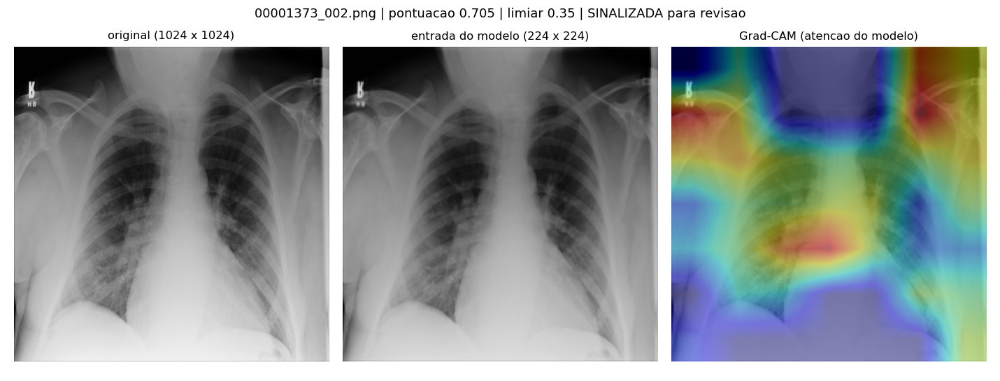
</p>
<p align="center">
  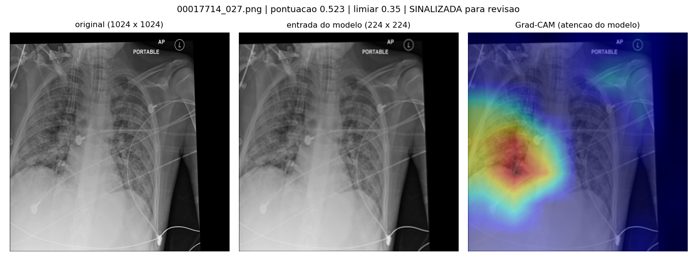
</p>

Os exemplos 2 e 4 estão em `assets/nb3_exemplo_2.png` e `assets/nb3_exemplo_4.png`. Duas observações sobre o Grad-CAM, sem generalização possível com quatro exemplos:

- No exemplo 1 (acerto), a região de maior atenção fica na área do coração, mas há também atenção na região do ombro e no canto superior.
- No exemplo 3 (falso positivo), a imagem traz as marcações AP e PORTABLE, além de vários tubos e cabos, e a região de maior atenção fica no lado esquerdo da imagem, sobre o pulmão e os tubos, e não sobre a silhueta cardíaca. Foi esse exemplo que motivou a análise por projeção do Ir Além 1.

O Grad-CAM mostra o que influenciou a pontuação do modelo. Ele não é uma localização anatômica validada.

---

## Ir Além 1 — Ética e Governança em Visão Computacional

Notebook: [`notebooks/04_fairness_governanca.ipynb`](notebooks/04_fairness_governanca.ipynb). Relatório (até 2 páginas): [`docs/relatorio_iralem1_fairness.md`](docs/relatorio_iralem1_fairness.md). Ficha do modelo: [`docs/ficha_do_modelo.md`](docs/ficha_do_modelo.md) e [`resultados/ficha_do_modelo.json`](resultados/ficha_do_modelo.json).

### Limitações do dataset

- **Desbalanceamento:** 4,43% de prevalência (141 de 3.185). Treino com 100 positivos, validação com 22 e teste com 19.
- **Exclusão de outras doenças:** 2.421 de 5.606 imagens foram excluídas, então o modelo não foi testado na separação de cardiomegalia de outros achados.
- **Sexo:** o dataset registra apenas M e F. A amostra original tem 2.472 mulheres e 3.134 homens (44,1% de mulheres). No experimento, as mulheres representam 44,5% das imagens e têm 73 positivos em 1.416 imagens (5,16%), contra 68 em 1.769 para os homens (3,84%). Essa diferença de prevalência não é significativa a 5% (teste exato de Fisher, p = 0,083).
- **Projeção:** a prevalência é maior nas radiografias AP (5,71%, 64 de 1.121) do que nas PA (3,73%, 77 de 2.064). Isso significa que a projeção carrega informação sobre o rótulo no próprio dataset.
- **Idade:** a faixa de 60 anos ou mais apresenta a maior prevalência (5,80%, 38 de 655).
- **Positivos por grupo no teste:** 9 mulheres e 10 homens. Qualquer comparação entre os sexos tem evidências fracas.

<p align="center">
  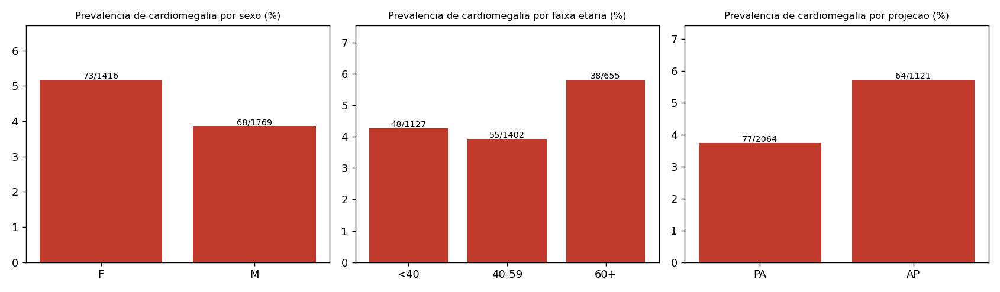
</p>

### Fairness por sexo no teste

Métricas por grupo, com o limiar de cada modelo: taxa de sinalização (paridade demográfica), recall (igualdade de oportunidade), taxa de falsos positivos, precisão (paridade preditiva) e AUC-ROC. A diferença F menos M vem com IC de 95% por bootstrap de pacientes. Quando o IC inclui zero, a diferença não está demonstrada. Com prevalências diferentes entre os grupos, não é possível igualar todas essas métricas simultaneamente (Chouldechova, 2017; Kleinberg et al., 2016); por isso, todas são apresentadas.

**ResNet50** (positivos acertados: F 8/9, M 9/10):

| Métrica | F | M | Diferença F - M | IC 95% | Leitura |
|---|---|---|---|---|---|
| taxa de sinalização | 0,325 | 0,373 | -0,048 | [-0,142 a 0,046] | diferença não demonstrada |
| recall | 0,889 | 0,900 | -0,011 | [-0,301 a 0,573] | diferença não demonstrada |
| falsos positivos | 0,297 | 0,351 | -0,054 | [-0,145 a 0,032] | diferença não demonstrada |
| precisão | 0,127 | 0,096 | 0,031 | [-0,094 a 0,153] | diferença não demonstrada |
| AUC-ROC | 0,843 | 0,855 | -0,013 | [-0,135 a 0,243] | diferença não demonstrada |

**CNN simples** (positivos acertados: F 1/9, M 5/10):

| Métrica | F | M | Diferença F - M | IC 95% | Leitura |
|---|---|---|---|---|---|
| taxa de sinalização | 0,149 | 0,087 | 0,062 | [-0,000 a 0,130] | diferença não demonstrada |
| recall | 0,111 | 0,500 | -0,389 | [-0,723 a 0,200] | diferença não demonstrada |
| falsos positivos | 0,151 | 0,070 | 0,081 | [0,023 a 0,142] | diferença observada nesta amostra |
| precisão | 0,034 | 0,227 | -0,193 | [-0,438 a 0,056] | diferença não demonstrada |
| AUC-ROC | 0,482 | 0,809 | -0,327 | [-0,496 a -0,099] | diferença observada nesta amostra |

<p align="center">
  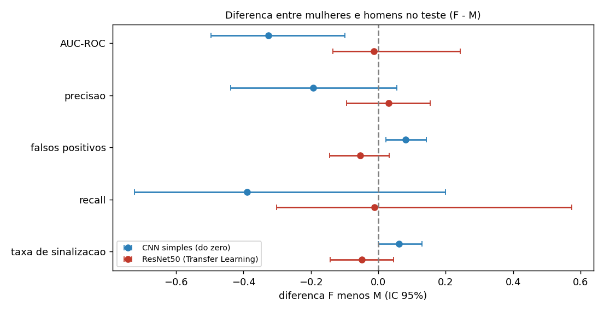
</p>

**Leitura:**

- **ResNet50:** nenhuma diferença demonstrada. Isso não prova igualdade: o recall é 0,889 para mulheres e 0,900 para homens, mas o IC da diferença é [-0,301 a 0,573], muito largo, porque cada grupo tem cerca de 10 positivos.
- **CNN simples:** duas das cinco métricas excluem zero. A AUC-ROC é 0,482 para mulheres e 0,809 para homens (diferença de -0,327, IC [-0,496 a -0,099]), e a taxa de falsos positivos é de 15,1% para mulheres e 7,0% para homens (diferença de 0,081, IC [0,023 a 0,142]). A AUC-ROC de 0,482 para mulheres é compatível com ordenação ao acaso, com apenas 9 positivos.
- **Cuidado com múltiplas comparações:** foram 10 comparações (5 métricas em 2 modelos), sem correção para testes múltiplos, e 2 delas excluem zero. Esses dois resultados são hipóteses a serem investigadas com mais dados, não conclusões.

### Projeção da radiografia (AP e PA) e faixa etária

A ResNet50, entre as imagens **sem achados** do teste:

| Projeção | Imagens | Sem achados | Falsos positivos | Taxa de falsos positivos (IC 95% de Wilson) | Positivos acertados |
|---|---|---|---|---|---|
| PA | 306 | 298 | 77 | 25,8% [21,2% a 31,1%] | 6/8 |
| AP | 140 | 129 | 63 | 48,8% [40,4% a 57,4%] | 11/11 |

A taxa de falsos positivos é mais do que o dobro em AP (48,8% contra 25,8%; teste exato de Fisher, p < 0,001). Isso sustenta a hipótese de que o modelo reage a características associadas à projeção AP e não apenas à silhueta cardíaca. Há uma ressalva: o AP também apresenta maior prevalência de cardiomegalia no dataset (5,71% contra 3,73%), então parte da sensibilidade ao AP pode refletir uma correlação real entre projeção e rótulo, e não foi isolado o que o modelo usa no exame AP. O recall por projeção é apenas descritivo: positivos acertados em AP: 11/11 e em PA: 6/8.

Por faixa etária (mesmo modelo, imagens sem achados):

| Faixa etária | Imagens | Sem achados | Taxa de falsos positivos (IC 95% de Wilson) | Positivos acertados |
|---|---|---|---|---|
| <40 | 174 | 167 | 28,7% [22,4% a 36,0%] | 6/7 |
| 40-59 | 184 | 178 | 33,7% [27,2% a 40,9%] | 6/6 |
| 60+ | 88 | 82 | 39,0% [29,2% a 49,8%] | 5/6 |

A taxa de falsos positivos cresce com a idade, mas os intervalos se sobrepõem: a diferença entre as faixas não se evidencia.

### Experimento de mitigação: limiares por sexo

O experimento escolhe, **na validação**, um limiar por sexo que iguala a taxa de sinalização de cada grupo à taxa geral do limiar original (CNN: 10,4% das imagens da validação; ResNet50: 35,5%). Depois aplica esses limiares no teste, sem reajuste. Não se igualou o recall porque a validação tem 5 homens positivos (e 17 mulheres), o que é insuficiente para estimar um limiar.

| Modelo | Métrica | Diferença F - M com limiar único | Diferença F - M com limiar por sexo |
|---|---|---|---|
| CNN simples | taxa de sinalização | 0,062 [-0,000 a 0,130] | -0,004 [-0,071 a 0,061] |
| CNN simples | recall | -0,389 [-0,723 a 0,200] | -0,389 [-0,723 a 0,200] |
| CNN simples | falsos positivos | 0,081 [0,023 a 0,142] | 0,011 [-0,048 a 0,071] |
| ResNet50 | taxa de sinalização | -0,048 [-0,142 a 0,046] | -0,048 [-0,142 a 0,046] |
| ResNet50 | recall | -0,011 [-0,301 a 0,573] | -0,011 [-0,301 a 0,573] |
| ResNet50 | falsos positivos | -0,054 [-0,145 a 0,032] | -0,054 [-0,145 a 0,032] |

- **CNN simples:** os limiares por sexo são 0,802 (F) e 0,769 (M), contra 0,79 do limiar único. A diferença de falsos positivos cai de 0,081 para 0,011, com IC que inclui zero. Positivos sinalizados no teste: 6 de 19, antes e depois. Imagens sinalizadas: 51 para 54 de 446. O recall e a AUC-ROC não mudam.
- **ResNet50:** os limiares por sexo saem praticamente iguais (0,350 e 0,350, contra 0,35), porque, na validação, as pontuações têm distribuição semelhante entre os dois sexos. O experimento não altera nada: positivos 17 para 17, imagens sinalizadas 157 para 157.

Isto é um experimento, não uma recomendação. Usar o sexo como entrada da decisão faz com que o mesmo escore tenha significados diferentes por grupo, pode ter restrições éticas e legais em contexto clínico e não garante igualdade de benefício entre pacientes. O notebook e o relatório abordam esses custos.

<p align="center">
  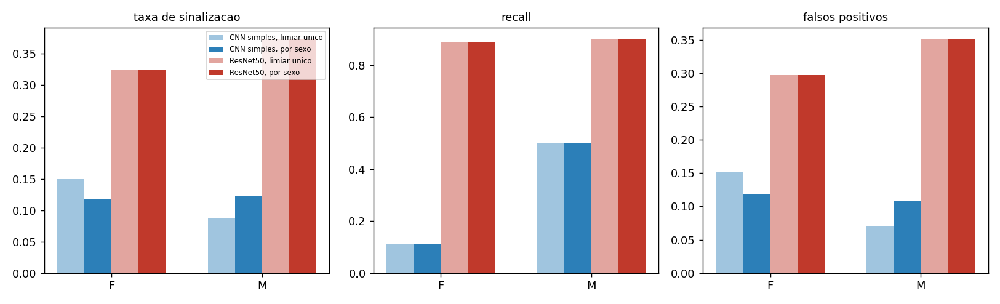
</p>

### Ficha do modelo

O Notebook 4 gera `ficha_do_modelo.json` e `.md` com o contrato de uso (entrada, saída, limiar, aviso), o desempenho no teste, as diferenças por sexo e as limitações, todos extraídos das tabelas calculadas. A ficha foi pensada para que as fases seguintes reaproveitem, em vez de copiarem números à mão: por exemplo, citar as limitações em um assistente conversacional e usar o contrato de entrada e saída em uma integração. Isso é uma intenção de projeto: nenhuma fase seguinte consome a ficha ainda.

---

## Ir Além 2 — Integração com aplicativo mobile

**Não implementado.** Esta fase optou apenas pelo Ir Além 1. O protótipo é um notebook interativo, o formato aceito pela Parte 2 do enunciado.

---

## Como executar no Google Colab

Os notebooks devem ser executados em ordem e guardam os dados no Google Drive, em `MyDrive/Pulso_F4`. Cada notebook monta o Drive e verifica se os arquivos do notebook anterior existem.

| Notebook | Ambiente | O que precisa |
|---|---|---|
| [`01_preprocessamento.ipynb`](https://colab.research.google.com/github/flango2023/Pulso_F4/blob/main/notebooks/01_preprocessamento.ipynb) | CPU | Credenciais do Kaggle nos Secrets do Colab (`KAGGLE_USERNAME` e `KAGGLE_KEY`) ou upload do `kaggle.json`. Nunca versionar o token |
| [`02_cnn_transfer_learning.ipynb`](https://colab.research.google.com/github/flango2023/Pulso_F4/blob/main/notebooks/02_cnn_transfer_learning.ipynb) | GPU | Saídas do Notebook 1 no Drive |
| [`03_prototipo.ipynb`](https://colab.research.google.com/github/flango2023/Pulso_F4/blob/main/notebooks/03_prototipo.ipynb) | CPU | Modelo e saídas do Notebook 2 e o dataset no Drive |
| [`04_fairness_governanca.ipynb`](https://colab.research.google.com/github/flango2023/Pulso_F4/blob/main/notebooks/04_fairness_governanca.ipynb) | CPU | Previsões do Notebook 2 e o CSV original do dataset no Drive |

Para refazer a comparação pareada a partir do repositório, sem o Drive:

```bash
pip install numpy pandas scikit-learn
python scripts/comparacao_pareada.py     # lê resultados/ e grava resultados/comparacao_pareada.json
```

Versões usadas na execução final do Notebook 2: Python 3.13.16, TensorFlow 2.21.0, Keras 3.13.2, NumPy 2.4.6, scikit-learn 1.6.1.

---

## Governança e limitações

O eixo de Responsible AI documentado nas fases anteriores continua nesta fase:

- Os rótulos vêm de laudos processados automaticamente e não têm validação clínica independente.
- O teste tem apenas 19 casos positivos (9 mulheres e 10 homens). Todas as métricas têm intervalos amplos e devem ser interpretadas como estimativas.
- O limiar vem de uma validação com 22 positivos, e a escolha é instável.
- Os modelos têm precisão baixa. O protótipo ilustra o fluxo; não é um instrumento de triagem.
- A pontuação não é calibrada e não representa probabilidade de doença.
- O modelo foi treinado e testado em uma única fonte de dados (NIH), sem validação externa.
- Há apenas uma divisão dos dados, sem validação cruzada; portanto, a variabilidade decorrente de outras divisões de pacientes não foi avaliada.
- A ResNet50 apresenta sensibilidade à projeção AP. Um modelo com esse comportamento pode reproduzir diferenças entre contextos de atendimento em vez de medir cardiomegalia.
- O dataset registra apenas sexo binário. Outras identidades, raça, etnia e condição socioeconômica não puderam ser avaliadas.
- Os resultados variam entre execuções e entre CPU e GPU.
- A pasta `resultados/` guarda saídas pequenas. As imagens do NIH e os modelos treinados não estão no repositório.

Nenhum componente desta fase deve ser utilizado para diagnóstico ou apoio a decisão clínica.

### Rastreabilidade dos artefatos

Diferenciando o que está no repositório do que é gerado em execução (ponto destacado na avaliação da Fase 2):

| Artefato | No repositório | Gerado em execução ou fora do repositório |
|---|---|---|
| Notebooks executados, com as saídas | Sim | — |
| Imagens do NIH (amostra) | Não (volume e atribuição) | Baixadas pelo Notebook 1 via API do Kaggle para o Drive |
| Arrays `.npz` (treino, validação, teste) | Não | Gerados pelo Notebook 1 no Drive |
| Modelos `.keras` | Não (`.gitignore`) | Gerados pelo Notebook 2 no Drive |
| `splits.csv`, `pipeline_resumo.json`, métricas, previsões, tabelas de fairness | Sim, em `resultados/` | Gerados nos notebooks e copiados do Drive |
| Figuras em `assets/` | Sim | Geradas pelos notebooks |
| `comparacao_pareada.json` | Sim | Gerado por `scripts/comparacao_pareada.py` a partir de `resultados/` |
| Interface com widgets do Notebook 3 | O código, sim | A interface não persiste no `.ipynb` salvo. Os quatro exemplos fixos registram os resultados |

---

## Pendências para fases seguintes

**Modelo e avaliação**
- Tratar o viés de projeção: treinar com balanceamento por projeção AP/PA ou restringir a PA, e repetir a medida de falsos positivos por projeção.
- Medir a variação entre execuções e entre divisões: validação cruzada por paciente e várias sementes.
- Aumentar o número de casos positivos usando o dataset completo do NIH (Kaggle: `nih-chest-xrays/data`, link citado no enunciado), para dar poder estatístico às comparações entre grupos.
- Calibrar as pontuações e escolher o limiar com base no custo clínico, não apenas no F1.
- Validação externa, com dados de outra instituição.
- Comparar com a VGG16, que não foi testada.

**Governança**
- Aplicar correção para múltiplas comparações quando houver mais dados.
- Estender a análise de fairness a outras variáveis quando existirem nos dados.

**Herdadas de fases anteriores**
- Conversão do sinal de ECG em imagem em escala de cinza e uso de CNN (Ir Além 2 da Fase 2).
- Integrar o módulo de imagem ao fluxo de sinais do Pulso Band (Fase 3) na plataforma da Fase 7.

**Não implementado nesta fase**
- Ir Além 2 (aplicativo mobile).

---

## Aviso importante

Este projeto é acadêmico e tem finalidade exclusivamente educacional. Os dados, modelos e análises produzidos não devem ser utilizados para diagnóstico clínico, triagem médica ou qualquer decisão relacionada à saúde de pacientes reais. Nenhum componente foi validado clinicamente.

---

## Autor

Richard Schmitz
Graduação Tecnológica em Inteligência Artificial — FIAP
Turma 2TIAOR-2026

GitHub: https://github.com/flango2023

LinkedIn: https://www.linkedin.com/in/richard-schmitz01/
