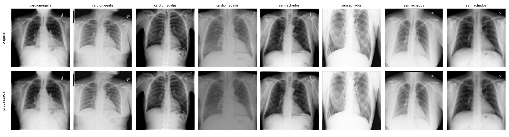

# Relatório Parte 1 — Pré-processamento e Organização das Imagens
**Projeto:** Pulso — Inteligência Cardiológica com Consciência de Dados  
**Fase 4:** Coração em Imagens — Assistente Cardiológico Virtual com Visão Computacional  
**Dataset:** NIH Chest X-rays (versão amostra)  
**Repositório:** [github.com/flango2023/Pulso_F4](https://github.com/flango2023/Pulso_F4)  
**Autor:** Richard Schmitz — RM 567951 — Turma 2TIAOR-2026

---

## 1. Visão geral do fluxo

A Parte 1 prepara radiografias de tórax para treinar redes neurais convolucionais que detectam **cardiomegalia** (aumento da silhueta cardíaca). O fluxo implementado no notebook `notebooks/01_preprocessamento.ipynb` é:

```
seleção do dataset → rótulo e limpeza → divisão por paciente → pré-processamento → conferência
```

Todos os números deste relatório vêm da execução do notebook (`resultados/pipeline_resumo.json` e `resultados/splits.csv`).

---

## 2. Dataset selecionado

| Campo | Informação |
|---|---|
| Nome | NIH Chest X-rays, versão amostra |
| Fonte | Kaggle: `nih-chest-xrays/sample` (versão reduzida do dataset indicado no enunciado) |
| Provedor | NIH Clinical Center |
| Conteúdo | 5.606 radiografias de tórax frontais em PNG (1024 x 1024 pixels) e um CSV com achados, paciente, idade, sexo e projeção |
| Rótulos | Extraídos dos laudos por processamento de linguagem natural (Wang et al., CVPR 2017), sem validação clínica independente |
| Licença e atribuição | Segundo a documentação do Google Cloud, sem restrições de uso, com atribuição obrigatória: citar o artigo, linkar o site de download do NIH e reconhecer o NIH Clinical Center. O campo de licença do Kaggle não foi consultado |

A versão amostra foi escolhida porque cabe em uma sessão do Colab sem mudar o que a Parte 1 precisa demonstrar.

---

## 3. Etapas do pipeline e justificativas

| Etapa | Escolha | Justificativa |
|---|---|---|
| Rótulo | Cardiomegalia (1) se o laudo contém `Cardiomegaly`. Sem achados (0) se é `No Finding` | Mantém o foco cardiovascular e dá um problema binário |
| Exclusão | Imagens com outras doenças e sem cardiomegalia (2.421 de 5.606) | Evita um rótulo 0 ambíguo. Limitação: o modelo não é testado contra outras doenças |
| Metadados | Idade inválida (negativa ou acima de 100 anos) vira valor ausente | Um dado inválido continua visível como inválido, e não é trocado por valor plausível |
| Conversão de formato | Escala de cinza, 1 canal | Radiografia é monocromática, e canais extras seriam redundantes |
| Redimensionamento | 224 x 224, interpolação LANCZOS | Entrada padrão de VGG16 e ResNet, usadas no Transfer Learning |
| Normalização | 0 a 255 para 0 a 1, aplicada dentro do modelo (Notebook 2) | Os arquivos ficam em `uint8`, quatro vezes menores que `float32` |
| Formato salvo | Arrays `uint8` em `.npz` | Carregamento rápido, sem decodificar PNG a cada época |
| Divisão | **Por paciente**, estratificada pelo rótulo, cerca de 70% / 15% / 15% (`StratifiedGroupKFold`, semente 42) | Ver abaixo |

### Por que dividir por paciente

Cada paciente tem em média 1,15 imagens (máximo de 6). Dividir por imagem colocaria radiografias do mesmo paciente no treino e no teste, e o modelo seria avaliado em imagens quase iguais às que já viu, o que infla as métricas. A divisão por paciente evita esse vazamento. O teste só é usado na avaliação final.

---

## 4. Resultado do pipeline

3.185 imagens ficaram no experimento (3.044 sem achados e 141 com cardiomegalia, prevalência de 4,43%), de 2.762 pacientes.

| Partição | Imagens | Pacientes | Positivos | Prevalência | Sexo F | Sexo M |
|---|---|---|---|---|---|---|
| Treino | 2.277 | 1.975 | 100 | 4,39% | 990 | 1.287 |
| Validação | 462 | 392 | 22 | 4,76% | 232 | 230 |
| Teste | 446 | 395 | 19 | 4,26% | 194 | 252 |

A prevalência é parecida nas três partições, o que mostra que a estratificação funcionou. O teste tem só 19 positivos, e o notebook emite um aviso por isso: métricas e comparações entre grupos devem ser lidas como hipóteses.

<p align="center">
  
</p>

*Quatro imagens de cada classe, antes (linha de cima) e depois (linha de baixo) do pré-processamento.*

---

## 5. Verificações de qualidade

- Todo registro do CSV tem a imagem correspondente (registros sem imagem: 0).
- O notebook confere por `assert` que nenhum paciente aparece em mais de uma partição.
- Idades: 3.184 de 3.185 registros têm idade válida, e 1 foi marcado como inválido. Na primeira execução, a idade (texto como `058Y`) foi convertida em ausente sem aviso. O parsing foi corrigido, e o notebook agora para com erro se nenhuma idade for lida.
- A conferência visual das imagens processadas não mostrou corte, inversão ou área em branco.

---

## 6. Limitações registradas

- Rótulos de laudos, sem validação clínica independente.
- Poucos positivos (141 no total, 19 no teste).
- Imagens com outras doenças foram excluídas.
- A redução de 1024 x 1024 para 224 x 224 perde resolução e pode apagar detalhes finos.
- Uma única divisão dos dados.
- As imagens e os arrays não estão no repositório (volume e atribuição). Eles são gerados pelo notebook no Google Drive.

---

**Referências:** Wang X. et al. (2017), *ChestX-ray8: Hospital-scale Chest X-ray Database and Benchmarks on Weakly-Supervised Classification and Localization of Common Thorax Diseases*, IEEE CVPR (https://arxiv.org/abs/1705.02315). Download oficial do NIH: https://nihcc.app.box.com/v/ChestXray-NIHCC.

*Projeto acadêmico. Nada neste relatório produz diagnóstico nem deve apoiar decisão clínica.*
